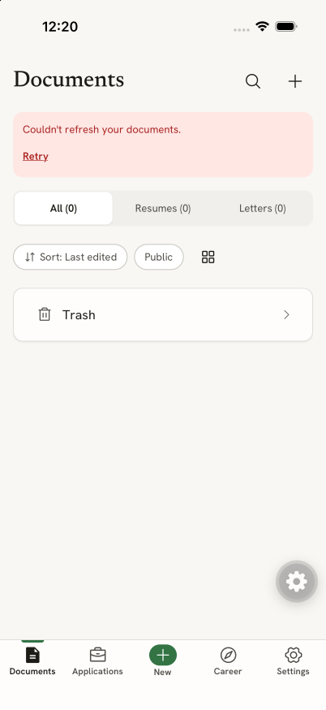
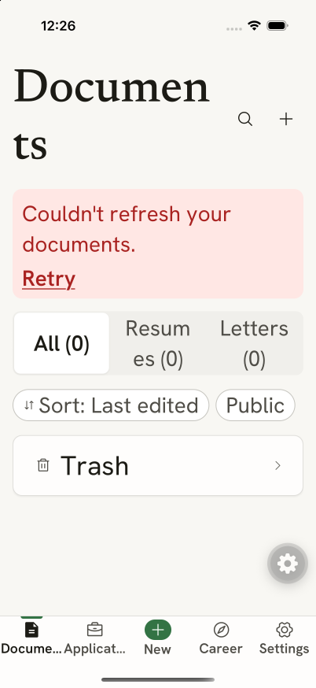
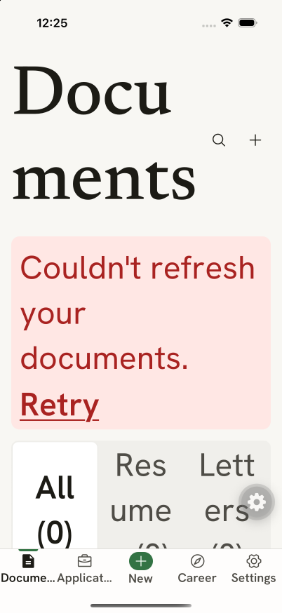
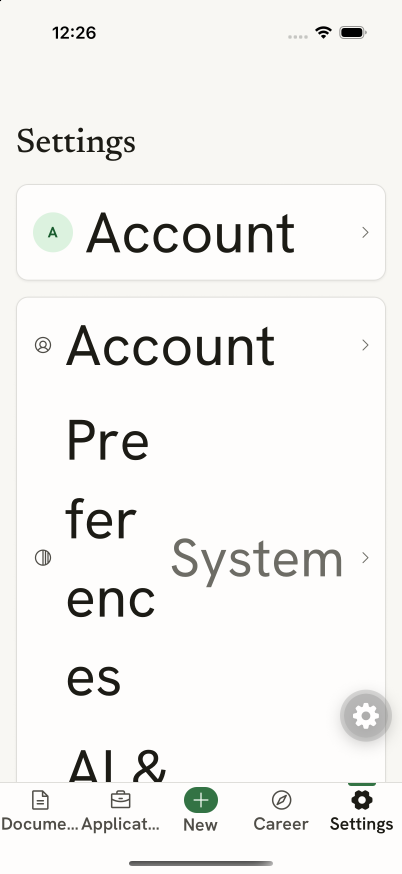

# iPhone experience audit

Method: design review only (detector not applicable, native platform), supplemented by native/source quality audit. Independent design assessment: `/root/iphone_design_review`; runtime inspection and synthesis: parent thread.

Review date: 2026-10-18. Source: `mobile/native-app`, `9e4f78b46`. Scope: native iPhone experience in `apps/mobile`; review only, no app code changes.

## Verdict

Keep the Desk & Paper identity. Warm surfaces, restrained green, document previews, and the Write / Page / Design / Check division suit the product. The biggest improvements are practical: protect interrupted work, keep large-text layouts usable, and make routine tasks shorter.

**Eight findings: 3 P1 major, 5 P2 usability. No P0 established in this review.** Design/usability score: **25/40, provisional**. This is an expert review, not a user study or release certification.

## Evidence and coverage

- Current JavaScript served from this checkout through task-owned Metro on loopback port 8111, using an existing iOS Debug development client. No native build performed.
- Live simulator: `rr-smoke-ios`, iPhone 17 Pro, iOS 26.5, 402 × 874 pt. Inspected Documents and Settings, default and accessibility text sizes, and light/dark Documents. A cold relaunch was needed for the captured text-size changes.
- The simulator's saved test server, `http://localhost:3140`, was unavailable. Live screenshots deliberately show the resulting refresh-error state. This is an environment condition, not a reported production outage or authentication defect.
- Primary editing, sharing, applications, interview, and career flows reviewed in current source. Independent reviewer also inspected older committed iOS smoke screenshots for visual context. Historical captures do not certify current behavior; findings below rely on current source unless explicitly marked reproduced.
- Store-capture simulator was already owned by another session and was not driven. A fresh-device attempt failed with `xcrun simctl openurl did not answer within 20000ms`, followed by `Daemon request timed out`; it supplied no usable review evidence. Extra simulator was shut down.
- Hindsight searches failed with backend/embedding errors. An inspected initiative page mixed historical phases; no completion claims from it are used here. Current decisions and implementation govern this review.

## Prioritized findings

### 1. [P1] Large text can consume the entire Documents viewport

**Evidence: reproduced in current JavaScript. Category: accessibility/adaptivity.**

At `accessibility-large`, “Documents” breaks mid-word into “Documen / ts”; bottom navigation truncates Documents and Applications. At `accessibility-extra-extra-extra-large`, title, refresh-error banner, and type filters consume the viewport; the actual list and remaining controls have no usable visible area. Settings also squeezes Preferences into several fragments beside its value.

**Source:** [collection-header.tsx:82](../../../../../apps/mobile/src/components/collection-header.tsx#L82), [library.tsx:241](../../../../../apps/mobile/src/features/documents/library.tsx#L241), [app-tabs.tsx:158](../../../../../apps/mobile/src/shell/app-tabs.tsx#L158), [layout.tsx:123](../../../../../apps/mobile/src/ui/layout.tsx#L123).

**Impact:** users who need larger text lose efficient access to documents and cannot read complete navigation labels. Fixed chrome competes with content as text grows.

**Recommendation:** make collection chrome reflow with text scale: stack actions, use a suitable title treatment, and place nonessential filters/error detail in scrollable content. Stack settings values below labels when horizontal space runs out. Let navigation remain identifiable at large text. Do not fix this by disabling font scaling.

**Acceptance:** at default, Accessibility Large, and largest accessibility size, Documents list remains reachable with and without refresh errors; labels stay understandable; Settings labels do not break into fragments. Check at a smaller iPhone width too. Suggested pass: `$impeccable adapt`.

### 2. [P1] Incidental sheet dismissal discards unsaved job/interview work

**Evidence: current-source confirmed; gesture loss not replayed on device. Category: user control/error prevention.**

Job form state is component-local; parent unmounts the form on dismissal. Interview form explicitly remounts on each opening. Both forward the shared sheet's dismissal directly to `onClose`. Shared phone sheet permits backdrop dismissal and swipe-down dismissal. Neither form protects dirty edits.

**Source:** [add-sheet.tsx:57](../../../../../apps/mobile/src/features/applications/add-sheet.tsx#L57), [add-sheet.tsx:197](../../../../../apps/mobile/src/features/applications/add-sheet.tsx#L197), [list-screen.tsx:459](../../../../../apps/mobile/src/features/applications/list-screen.tsx#L459), [interview-sheet.tsx:131](../../../../../apps/mobile/src/features/application-detail/interview-sheet.tsx#L131), [overlays.tsx:207](../../../../../apps/mobile/src/ui/overlays.tsx#L207).

**Impact:** a swipe or background tap can erase pasted job text, corrected fields, interview participants, and notes. Autosaving document editors establish a safer expectation than these explicit-save forms provide.

**Recommendation:** reuse the existing dirty/pending dismissal behavior demonstrated by [career/shared.tsx:72](../../../../../apps/mobile/src/features/career/shared.tsx#L72). Retain form state until the user explicitly discards it. Keep Cancel/Save visible and handle pending saves honestly.

**Acceptance:** edit a field, dismiss by swipe/backdrop/Cancel, choose Keep editing, and retain every field. Confirm Discard clears it. A pending save must not invite conflicting resubmission. Suggested pass: `$impeccable harden`.

### 3. [P1] Cold launch has no normal offline route to unsynced documents

**Evidence: complete current-source path; matching-account offline reproduction still required. Category: recovery/continuity.**

Normal launch redirects to Documents. QueryClient starts empty, Documents queries the API, and the library renders only `documents.data ?? []`. Unsynced draft recovery exists, but requires opening a known document ID; the library does not surface those account-scoped stored records.

**Source:** [app/index.tsx:9](../../../../../apps/mobile/app/index.tsx#L9), [app/_layout.tsx:24](../../../../../apps/mobile/app/_layout.tsx#L24), [queries.ts:30](../../../../../apps/mobile/src/features/documents/queries.ts#L30), [library.tsx:179](../../../../../apps/mobile/src/features/documents/library.tsx#L179), [draft/store.ts:161](../../../../../apps/mobile/src/draft/store.ts#L161).

**Impact:** after a process restart without server access, locally persisted unsynced work remains stored but cannot be reopened through the normal library. This is an access gap, not established data loss. A known deep link may still open the record.

**Recommendation:** expose the current account's pending local documents in Documents as “Unsynced on this device.” Preserve server/account isolation. Full offline caching of every clean document is unnecessary for this fix.

**Acceptance:** make an offline edit, terminate the app, reopen normally while offline, find the document in Documents, and recover the exact pending text. Reconnect and sync it; ensure another account sees none of those records. Suggested pass: `$impeccable harden`.

### 4. [P2] Quick job capture requires scrolling through a long form

**Evidence: current-source confirmed. Category: efficiency/cognitive load.**

Company and Role are followed by location, salary, source, URL, stage, document links, tags, follow-up fields, notes, description, and AI actions before Save job. Save sits inside scrolling content despite the shared Sheet supporting a pinned footer.

**Source:** [add-sheet.tsx:339](../../../../../apps/mobile/src/features/applications/add-sheet.tsx#L339), [add-sheet.tsx:443](../../../../../apps/mobile/src/features/applications/add-sheet.tsx#L443), [overlays.tsx:40](../../../../../apps/mobile/src/ui/overlays.tsx#L40).

**Impact:** optional details look like required work; a two-field capture becomes a long inspection task, especially with the keyboard open.

**Recommendation:** show Company, Role, and Stage first; put optional fields under More details; pin Save job in the existing footer. Keep extracted posting content intact.

**Acceptance:** save a manual job after entering Company/Role without scrolling through optional fields. Save remains reachable with the software keyboard. Suggested pass: `$impeccable distill`.

### 5. [P2] Sharing a PDF starts with public-link configuration

**Evidence: current-source confirmed. Category: efficiency/information hierarchy.**

Share defaults to Link, even for private resumes. Download exposes five descriptive format rows before the filename and Download button. PDF is recommended but the recommendation does not shorten the path.

**Source:** [share/screen.tsx:24](../../../../../apps/mobile/src/features/share/screen.tsx#L24), [download.tsx:36](../../../../../apps/mobile/src/features/share/download.tsx#L36), [download.tsx:111](../../../../../apps/mobile/src/features/share/download.tsx#L111), [download.tsx:163](../../../../../apps/mobile/src/features/share/download.tsx#L163).

**Impact:** the common mobile task, handing a PDF to another app, requires finding the right section and scrolling through infrequent options.

**Recommendation:** provide an immediate Share PDF action with the existing sensible filename. Keep public-link controls separate; move less-used formats into a compact selector or Other formats. Retain export errors, offline limitations, and system sharing behavior.

**Acceptance:** reach the system PDF share sheet from the document in two taps, with a readable filename and no format-list scrolling. Suggested pass: `$impeccable adapt`.

### 6. [P2] Stage progress behaves like an edit control but announces tabs

**Evidence: current-source confirmed. Category: predictability/accessibility.**

Each progress label is a `tab`; tapping it immediately changes application stage. Except Saved → Applied, it directly mutates the record. The success toast offers no Undo.

**Source:** [sections.tsx:85](../../../../../apps/mobile/src/features/application-detail/sections.tsx#L85), [sections.tsx:99](../../../../../apps/mobile/src/features/application-detail/sections.tsx#L99).

**Impact:** an exploratory tap alters application history. Tab semantics suggest viewing content, not editing a record.

**Recommendation:** make the progress display informational and provide Change stage, or keep direct changes with explicit action semantics and Undo. Ordinary transitions do not need an extra confirmation dialog each time.

**Acceptance:** an accidental change is reversible; assistive technology identifies the action as changing stage. Suggested pass: `$impeccable clarify`.

### 7. [P2] Application detail does not rank the next useful task

**Evidence: current-source confirmed. Category: hierarchy/first-use clarity.**

For a Saved role without an interview, Next step offers Schedule an interview. Generic Open workspace follows, with resume/letter actions elsewhere. Users must infer which module to enter next.

**Source:** [sections.tsx:203](../../../../../apps/mobile/src/features/application-detail/sections.tsx#L203), [detail-screen.tsx:124](../../../../../apps/mobile/src/features/application-detail/detail-screen.tsx#L124), [sections.tsx:322](../../../../../apps/mobile/src/features/application-detail/sections.tsx#L322).

**Impact:** a newly saved role presents several plausible actions without a clear sequence.

**Recommendation:** use the existing stage/next-step data to choose one primary task: prepare application for Saved, prepare interview for an upcoming interview, and follow up when due. Use task names instead of Open workspace; keep secondary actions available.

**Acceptance:** each representative application state has one obvious relevant primary action. Suggested pass: `$impeccable clarify`.

### 8. [P2] Job dates require typing ISO strings on a phone

**Evidence: current-source confirmed. Category: input ergonomics/error prevention.**

Application and follow-up dates use plain TextField with `YYYY-MM-DD` helper text. Interview scheduling already owns a reusable native date field.

**Source:** [add-sheet.tsx:364](../../../../../apps/mobile/src/features/applications/add-sheet.tsx#L364), [add-sheet.tsx:405](../../../../../apps/mobile/src/features/applications/add-sheet.tsx#L405), [date-field.tsx:33](../../../../../apps/mobile/src/features/application-detail/date-field.tsx#L33).

**Impact:** users must recall a machine-oriented format and type separators, inviting avoidable validation errors.

**Recommendation:** reuse the existing native date field, preserving optional/empty follow-up dates and calendar-day/timezone semantics.

**Acceptance:** select application/follow-up dates without typing ISO strings; clear the optional follow-up date; confirm no date shifts across timezones. Suggested pass: `$impeccable adapt`.

## Design and usability scoring

Scores are expert judgments against inspected evidence, not measured completion rates. Independent source/design pass scored 26/40; synthesis scores status lower because failed cold-start library cannot surface pending work.

| Heuristic | Score / 4 | Main reason |
| --- | --- | --- |
| Visibility of system status | 2 | Good save indicators, weak cold-start offline discovery |
| Match with real world | 3 | Plain task language; some generic module terminology |
| User control and freedom | 2 | Dirty sheet dismissal |
| Consistency and standards | 3 | Coherent primitives; stage tabs have edit semantics |
| Error prevention | 2 | Discard and accidental stage-change risks |
| Recognition rather than recall | 3 | Labeled modes; dates demand ISO recall |
| Flexibility and efficiency | 2 | Long save/export paths |
| Aesthetic and minimalist design | 3 | Strong identity; optional controls compete with tasks |
| Error recovery | 3 | Retry, Undo and fallbacks exist in many flows |
| Help and documentation | 2 | Helpful copy; complex workflow sequence still implicit |
| **Total** | **25/40** | **Meaningful usability work remains** |

| Native quality dimension | Score / 4 | Evidence and limits |
| --- | --- | --- |
| Accessibility | 2 | Most controls labeled and sized generously; large-text failure reproduced; spoken VoiceOver untested |
| Performance | Not scored | Main library lists virtualized; no current device timing/frame/memory measurements |
| Appearance and theming | 3 | Semantic tokens; light/dark Documents inspected; no exhaustive contrast/increased-contrast audit |
| Platform conformance | 3 | Native stacks, sheets, pickers and system sharing; stage control semantics need correction |
| Adaptivity | 1 | Significant current large-text breakage; smaller phone and landscape not inspected |
| **Assessed total** | **9/16** | **Partial assessment; performance excluded** |

Platform verdict: recognizably a native app with a coherent product identity. Custom typography and icons are approved design decisions, not defects on their own. Current trust/accessibility gaps matter more than replacing the visual system.

## What works

- Write / Page / Design / Check gives each editor mode a distinct job. Actual page previews ground editing in the resulting document.
- Check connects a specific problem to a corrective action with supportive language rather than punitive scoring alone.
- Semantic light/dark tokens, minimum button targets, reusable fields, keyboard-aware entry/workspace screens, explicit save states, locked-document behavior, and many Retry/Undo paths form a solid base.
- Core document/application collections use FlatList/SectionList. Preview loading is limited by visibility, and page gestures reuse the raster during pinch. Preserve these choices; do not infer smooth physical-device performance from source alone.

## Cognitive load and everyday friction

The app looks calm but exposes configuration early in job capture and export. More than four alternatives compete in several surfaces: creation, export formats, and workspace destinations. Creation at least distinguishes primary and secondary paths; export/forms should do the same.

- Distracted phone user: losing dirty forms and scrolling to Save are the largest risks.
- First-time user: Saved → preparation needs a clearer action hierarchy; module names alone do not teach sequence.
- Large-text user: shell layout must adapt before more visual polish ships.

The strongest emotional moment is seeing a polished page. The weakest moments are setup, long forms, incidental dismissal, and returning without connectivity. Optimize the endings around “Job saved” and “PDF ready.”

## Secondary observations and validation targets

- Workspace has seven horizontally scrolling destinations, hides its scroll indicator, and has no active-tab scroll positioning: [workspace-chrome.tsx:103](../../../../../apps/mobile/src/shell/workspace-chrome.tsx#L103). Verify direct navigation to later tabs before calling it a reproduced defect. Keep the active destination visible and signal overflow if confirmed.
- Knowledge hides Facts / Stories / Preferences behind a sheet picker: [knowledge.tsx:21](../../../../../apps/mobile/src/features/career/knowledge.tsx#L21). A three-choice inline control could reduce repeated switching if that matches actual use.
- Settings repeats Account as both avatar row and navigation row. Clarify one entry's role or remove duplication after confirming both destinations.
- Decorative Phosphor nodes appear in UIAutomation snapshots using testID strings. That does **not** establish that VoiceOver speaks them. No screen-reader defect is counted from those identifiers.
- Do not revive old smoke screenshot bugs already changed in source: duplicated workspace tab rows, old Applications toolbar density, or old Share header collisions.

## Recommended sequence

1. `$impeccable harden`: dirty-form protection and current-account unsynced-document entry point.
2. `$impeccable adapt`: large-text layouts, native date input, fast PDF sharing.
3. `$impeccable distill`: quick Save job with optional details and pinned action.
4. `$impeccable clarify`: application stage semantics and state-aware next actions.
5. `$impeccable polish`: only after task and accessibility behavior is verified.

Useful follow-up choices: **trust/recovery**, **large-text accessibility**, or **faster daily tasks**. Scope options: **three major findings first**, or **all eight findings**. No implementation started.

## Limits

No production/store outage inferred from the unavailable local test backend. No signed-release, physical-device, live-provider, spoken VoiceOver, full software-keyboard, smaller-iPhone, landscape, or end-to-end offline-account certification. No current performance benchmark or exhaustive contrast measurement. No automated test suite run for this read-only audit. Source, runtime inspection, and historical screenshots remain distinct evidence levels.

## Run notes

- Root `pnpm lint:agent`: passed. Root `pnpm format:check`: passed (1900 matched files). Report paths are excluded by repository formatting rules; a direct Oxfmt invocation found no eligible target there.
- All 36 local image/source references resolved; referenced source line numbers exist.
- Interactive review preview at 728 px: rendered with no console messages. Report and five fresh simulator screenshots retained in this folder.
- Impeccable context resolved no target slug for the directory, so automatic critique snapshot/trend storage was skipped. This report is the retained archive.
- Web detector/overlay/live server do not apply to native app review. No browser was substituted for native screenshots.
- Simulator appearance and content size restored to Light / Large after inspection; test accounts, documents and stored drafts were not edited. Only task-owned Metro on 8111 stopped; existing services left running.
